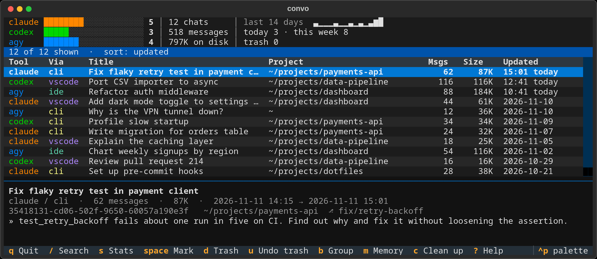

# convo

One terminal view of every conversation you've had with **Claude Code**, **Codex** and **Antigravity (agy)**, whether it started in the CLI or in VS Code. Browse, search, read, resume, rename, trash and export them from one place.



## What it can do

- **List everything in one place:** conversations from Claude Code, Codex and Antigravity, started in a terminal, a VS Code panel or the Antigravity IDE.
- **Search:** titles, project folders, and everything said inside the conversations.
- **Read:** open any conversation, with or without tool output and thinking.
- **Resume:** reopen a conversation in the terminal program of the tool that owns it.
- **Rename:** the new title shows up in the owning tool as well.
- **Trash and restore:** nothing is erased until you empty convo's trash.
- **Export:** Markdown or JSON.
- **Clean up:** find empty conversations and files a tool left behind.
- **Stats:** counts per tool, messages, disk use and recent activity.

## What it cannot do

- **Linux only.** macOS and Windows are not supported.
- **Local conversations only.** Chats on claude.ai, ChatGPT or other web apps are not read, nor are conversations on a remote host reached over VS Code Remote SSH.
- **Resume always opens a terminal.** A conversation started in a VS Code panel resumes in that tool's CLI, not back in the panel.
- **Antigravity IDE conversations are only partly supported.** They can be listed, searched, read, renamed, trashed and exported. Resuming them is untested: convo hands the id to the `agy` CLI, which keeps its own store apart from the IDE's, so it may not open. If it does not, reopen the conversation in the IDE.
- **No editing.** convo never changes what was said in a conversation.
- **A running tool may lag.** An open VS Code panel or IDE can keep showing an old title or a trashed conversation until it restarts.
- **Helper threads are hidden.** Codex subagent and `codex exec` threads are not listed.

> **convo edits other tools' private data.** Rename and trash write to storage that Claude Code, Codex and Antigravity do not document and may change in any release. Trash is reversible until you empty it, and convo refuses to write when a store looks unfamiliar, but keep a backup of anything you cannot afford to lose.

## Install

```sh
pip install git+https://github.com/joshuaroy873/convo
# or from a checkout
pip install .
```

Requires Python 3.11+. The command is `convo`.

## Use

Run `convo` for the interactive view, or `convo some words` to open it already searched.

The panel at the top counts everything convo found: conversations per tool, totals, and how many were last active on each of the past 14 days. It stays the same while you search; `s` gives fuller stats for what is listed.

| Key | In the list | Inside a conversation |
|---|---|---|
| `enter` | open the conversation (or fold a group) | |
| `/` | search titles, projects and what was said (see below) | find text |
| `t` | cycle the tool filter | show or hide tool output and thinking |
| `o` | cycle the sort order | |
| `b` | group by project, by date, or not at all | |
| `r` | resume in the tool that owns it | |
| `y` | copy the command that resumes it | |
| `n` | rename | next match (`N` previous) |
| `space` | mark for a bulk trash | |
| `d` / `u` | trash the marked ones (or this one) / undo the last trash | |
| `e` / `E` | export Markdown / JSON | export Markdown |
| `[` `]` | | previous / next prompt |
| `s` | stats for the conversations listed | |
| `g` | quit, leaving your shell in the conversation's folder | |
| `m` | Claude's memory notes | |
| `c` | clean up orphans | |
| `?` | show all keys | show all keys |
| `esc` | clear marks, then the search | back |
| `q` | quit | back |

### Search

`/` searches titles, project folders, git branches and everything said inside the conversations. Matches from inside conversations appear a moment after the rest.

Mix words with these terms, in the `/` box or on the command line:

| Term | Shows |
|---|---|
| `tool:claude` | only Claude conversations |
| `tool:claude,codex` | Claude or Codex |
| `-tool:claude` | everything except Claude |
| `via:cli` | conversations started in a terminal |
| `via:vscode` | conversations started in a VS Code panel |
| `via:ide` | conversations started in the Antigravity IDE |
| `dir:backend` | project folder path contains "backend" |
| `dir:backend,!test` | contains "backend" but not "test" |
| `date:today`, `date:yesterday`, `date:week`, `date:month` | last active in that period |
| `date:<2d`, `date:>1w` | active within the last 2 days; not active for over a week |

`tool:` is which assistant you talked to and `via:` is where you ran it, so `tool:claude via:vscode` is Claude used from VS Code. A minus in front of a term, or `!` in front of a value, excludes it.

On the command line, write an exclusion as `tool:!agy` rather than `-tool:agy`, which the shell-side parser would read as an option.

### Commands

```sh
convo [search]                      # interactive view
convo list [--tool T] [--json] [search]
convo show <id> [--tools]           # print as Markdown
convo export <id> [-f md|json] [-o FILE] [--tools]
convo rename <id> "New title"
convo resume <id or search>         # by id, or the most recent match
convo rm <id>                       # move to trash
convo trash [list|restore [N]|empty]
convo rm <id> --dry-run             # show what a trash would move
convo orphans [--trash]             # empty conversations, missing projects, leftover files
convo stats [search]                # totals by tool and project, and when you were active
convo trash log                     # what was trashed, restored and deleted, and when
convo memory [--project DIR]        # the notes Claude keeps between sessions
convo config [--init]               # settings in use; --init writes a file of defaults
convo setup                         # let convo change your shell's folder (see below)
convo doctor                        # where each tool's data was found, and any problems
```

`<id>` can be any unique prefix of a conversation id. Exports get a new name rather than overwriting an earlier one.

### Settings

Optional, in `~/.config/convo/config.toml` (`convo config --init` writes it):

```toml
sort = "updated"      # updated | created | size | messages | title | project
group = "none"        # none | project | date
show_tools = false    # show tool output and thinking when a conversation opens
export_dir = ""       # where exports go; empty means ~/Documents/chat-exports
```

### Ending up in a conversation's folder

A program cannot change the folder of the shell that started it, so `g` needs a small shell function. `convo setup` adds one line to your shell profile (zsh, bash or fish); `convo init zsh` prints the function if you would rather add it yourself. Without it, `g` prints the `cd` command instead.

### Claude's memory notes

`m` (or `convo memory`) lists the notes Claude Code keeps per project between sessions, with the conversation that wrote each. Enter reads one; `d` moves it to the trash.

## Trash

`d` (or `convo rm`) moves a conversation's files out of the owning tool's storage into `~/.local/share/convo/trash`, together with the index records that pointed at it, so the tool no longer lists it. `u` (or `convo trash restore`) puts everything back. Nothing is erased until `convo trash empty`.

The confirmation lists every path and index record a trash will move, and each trash, restore and permanent delete is logged in `~/.local/share/convo/log.jsonl`.

### Cleaning up

`c` (or `convo orphans`) lists what is probably safe to remove: conversations with no messages, conversations whose project folder is gone, and files left behind for conversations that no longer exist. Each item says why it is listed, and removing one moves it to the trash.

A conversation in use cannot be trashed: one open in a running Claude Code session, or a Codex or Antigravity one written to in the last 90 seconds.

## What is read, and how

| Tool | Storage | Notes |
|---|---|---|
| Claude Code | `~/.claude/projects/<project>/<id>.jsonl` | Rename appends the same title record as `/rename`. |
| Codex | `~/.codex/sessions/**/rollout-*.jsonl`, `state_*.sqlite`, `session_index.jsonl` | A thread split across several rollout files is shown as one conversation. Subagent and `codex exec` threads are hidden. |
| Antigravity | `~/.gemini/antigravity{,-cli}/conversations/<id>.db` | Messages are protobuf with no published schema; the field layout was worked out from real data and may shift between agy versions. Rename is best effort. If a database cannot be read, the plain-text log agy keeps under `brain/<id>/.system_generated/logs/` is used instead. |

## Configuration

| Variable | Default | Purpose |
|---|---|---|
| `CLAUDE_CONFIG_DIR` | `~/.claude` | Claude Code data |
| `CODEX_HOME` | `~/.codex` | Codex data |
| `CONVO_AGY_HOME` | `~/.gemini` | Antigravity data |
| `CONVO_DATA` | `~/.local/share/convo` | trash |
| `CONVO_EXPORT_DIR` | `~/Documents/chat-exports` | exports |
| `CONVO_CACHE` | `~/.cache/convo` | scan cache |
| `CONVO_CONFIG` | `~/.config/convo/config.toml` | settings file |

## Development

```sh
pip install -e ".[dev]"
pytest
ruff check .
```

`python docs/screenshot.py` redraws the screenshot above from invented conversations (it needs Firefox for the PNG).

The tests build small made-up stores for each tool in a temporary folder; they never read a real home directory.

## Licence

MIT
